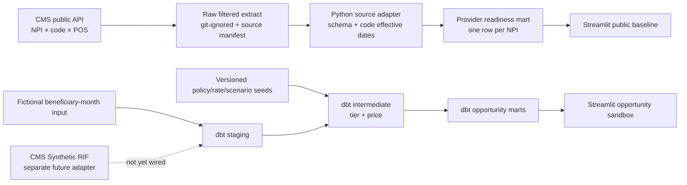

# APCM Opportunity Lab

**An explainable Medicare analytics project for understanding where primary-care practices have experience with care-management billing—and what a new APCM payment could mean.**

The repository now has two deliberately separate analytical surfaces:

1. **Public provider baseline:** a reproducible pipeline over CMS's 2024 NPI-level, code-level Medicare provider file. It measures visible predecessor care-management billing signals with suppression and data-grain limits shown in the UI.
2. **Opportunity sandbox:** a DuckDB + dbt beneficiary-month model using fictional inputs. It demonstrates tier assignment, scenario math, and possible displacement without presenting synthetic rows as national findings.

The split is a design decision: public provider aggregates can support historical provider-level signal analysis, but cannot be joined into patient-level APCM eligibility or same-month billing conflicts. Read [the architecture and data boundaries](docs/architecture.md) before interpreting results.

> **Current status:** this is a research prototype, not a national estimate, clinical determination, fee-schedule calculator, compliance tool, or billing recommendation. It does not yet contain the CMS Synthetic RIF claim pipeline or a validated national practice attribution model.

## Run the public-data experience

Requires Python 3.11 or later. The repository contains no patient claims or raw CMS provider extract.

```bash
python -m venv .venv
# Windows: .venv\Scripts\activate
# macOS/Linux: source .venv/bin/activate
python -m pip install -e .
python scripts/download_public_provider_use.py --year 2024
python scripts/build_public_readiness.py --year 2024
streamlit run app.py
```

Choose **Public provider baseline** in the sidebar. The CMS download is filtered to the versioned predecessor-service code list, paged through the CMS API, and written under `data/public_raw/`. The builder creates a one-row-per-NPI view and a lineage manifest under `data/public_processed/`. Both folders are git-ignored; reproduce them locally from the source.

## Run the opportunity sandbox

```bash
dbt build --project-dir . --profiles-dir .
streamlit run app.py
```

Choose **Opportunity sandbox**. Its input rows are generated by `python scripts/make_demo_data.py`; every row and dollar amount is fictional or illustrative. Seed rates are not official 2026 PFS values.

## What the public baseline measures

The public CMS provider-service file is grouped at **rendering NPI × HCPCS × place of service**. This project rolls selected 2024 CCM, complex CCM, PCM, TCM, BHI, and CoCM rows up to one record per NPI. It reports visible code-family breadth and service units. It does not have a valid denominator for unique attributed primary-care patients and therefore does not label provider volume “per 100 patients.”

CMS suppresses provider-service rows with 10 or fewer beneficiaries. A missing row is ambiguous: it may mean no billing or a suppressed value. NPI is a clinician/provider key, not a confirmed practice organization. This file is Original Medicare FFS Part B non-institutional claims; it excludes Medicare Advantage and does not represent a provider's full panel. See [the source inventory](docs/data_source_inventory.md) and [CMS methodology](https://data.cms.gov/sites/default/files/2025-04/MUP_PHY_RY25_202350312_Methodology_508.pdf).

## Architecture



Architecture decisions and trust boundaries are in [`docs/architecture.md`](docs/architecture.md); concise, dated choices are in [`docs/decision_log.md`](docs/decision_log.md).

## Repository map

| Path | Responsibility |
|---|---|
| `src/apcm_opportunity/` | Public-data aggregation and presentation layer |
| `scripts/download_public_provider_use.py` | Paginated CMS API source adapter and raw-source manifest |
| `scripts/build_public_readiness.py` | Deterministic NPI roll-up and SHA-256 lineage record |
| `models/` | DuckDB/dbt staging, tiering, pricing, and opportunity marts for beneficiary-month inputs |
| `seeds/` | Effective-dated code families, payment placeholders, and scenario parameters |
| `data/` | Fictional demo inputs; generated CMS extracts are ignored |
| `docs/` | Architecture, scope, data contracts, policy evidence, assumptions, validity, and roadmap |

## Human decisions and AI tooling

OpenAI Codex assisted with research, scaffolding, and implementation. The project keeps the important decisions reviewable in source control: which grain supports which claim, where suppression creates ambiguity, why public provider data and beneficiary-month simulation stay separate, and which estimates are placeholders. The tool attribution is explicit; generated code is not represented as unaided work.

## Known limitations and next milestones

- Wire CMS Synthetic RIF enrollment and claims files into a separate beneficiary-month adapter; apply CCW condition lookbacks and month-specific QMB status.
- Transcribe APCM overlap, consent, practitioner, and service-element rules from the final rules into cited, effective-dated policy tables.
- Replace illustrative rates with official year/locality PFS payment inputs and reconcile the published results.
- Validate primary-care attribution and NPI-to-practice organization mapping; report ties, suppression, and excluded settings.
- Add an interpretable national adoption forecast only after the target, predictors, cutoff, and freeze protocol are reproducible.

The ranked delivery plan is [`docs/production_roadmap.md`](docs/production_roadmap.md). A limitations-first client brief template is in [`docs/client_brief_template.md`](docs/client_brief_template.md).

## Selected references

- [CMS APCM services and requirements](https://www.cms.gov/medicare/payment/fee-schedules/physician-fee-schedule/advanced-primary-care-management-services)
- [CY2025 PFS Final Rule, Federal Register](https://www.federalregister.gov/documents/2024/12/09/2024-25382/medicare-and-medicaid-programs-cy-2025-payment-policies-under-the-physician-fee-schedule-and-other)
- [CY2026 PFS Final Rule, CMS](https://www.cms.gov/medicare/payment/fee-schedules/physician/federal-regulation-notices/cms-1832-f)
- [CMS public provider-service API](https://data.cms.gov/provider-summary-by-type-of-service/medicare-physician-other-practitioners/medicare-physician-other-practitioners-by-provider-and-service/api-docs)
- [CMS API query and paging documentation](https://data.cms.gov/api-docs)
- [CMS Synthetic RIF collection and user guide](https://data.cms.gov/collection/synthetic-medicare-enrollment-fee-for-service-claims-and-prescription-drug-event)
- [Reddy et al., CCM uptake, Annals of Family Medicine (2020)](https://doi.org/10.1370/afm.2573)
- [Primary Care Clinician Uptake of Medicare APCM Billing Codes, JGIM (online 2026-10-22)](https://doi.org/10.1007/s11606-026-10949-8)

