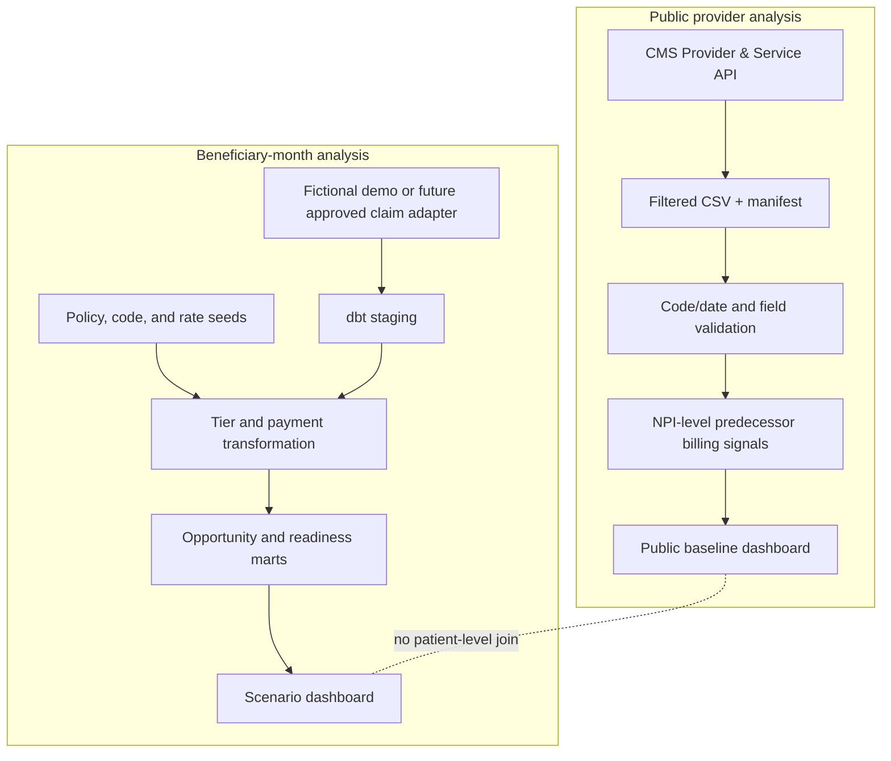

# System architecture and analytical boundaries

## Design objective

The project should make each output traceable to its source grain and assumptions. Public, provider-level evidence and beneficiary-level scenario logic have different capabilities, so they run through separate paths and meet only at the presentation layer as clearly labeled views.

## Component map

| Layer | Component | Responsibility | Must not do |
|---|---|---|---|
| Source adapter | CMS public API downloader | Fetch selected NPI × HCPCS × place-of-service rows; record dataset UUID, reporting year, code counts, retrieval time, and schema caveat | Infer zeros from missing/suppressed rows; claim an APCM outcome from predecessor codes |
| Landing | `data/public_raw/` | Keep an unmodified, reproducible source extract and its manifest local | Enter Git, be treated as the trusted analytic table, or retain provider names/streets in this project output |
| Public transform | `public_readiness.py` | Apply the active 2024 code-family mapping; validate NPI and numeric fields; collapse service rows to NPI; hash inputs and output | Use claims payment as the current APCM fee schedule; create a fake patient denominator |
| Public mart | `data/public_processed/` | Serve one-row-per-NPI historical signal summaries | Equate NPI with an organization, practice panel, or attributed beneficiary count |
| Scenario source | `data/beneficiary_months.csv` | Fictional row-grain inputs shaped like one beneficiary × service month × attributed practice | Be described as CMS synthetic data or national evidence |
| Warehouse | dbt staging → intermediate → marts | Type inputs, assign one tier per row, join versioned rates and scenario assumptions, aggregate opportunity | Hide policy rules in the Streamlit UI or use public aggregates to calculate patient conflicts |
| Presentation | Streamlit | Filter, display, and export labeled marts; show caveats at the point of interpretation | Recalculate policy rules, imply a forecast, or mutate source data |
| Forecast artifact | `freeze_forecast.py` | Hash and preserve a completed prediction snapshot once target and cutoff are pre-registered | Create a forecast from demo rows or silently overwrite a frozen file |

## Data flow

The dotted line is a deliberate **non-join**. The provider-service data can say that a billing NPI has visible 2024 CCM rows. It cannot establish which beneficiary received that service or whether an APCM claim conflicts in a particular month.

## Contracts and invariants

### Public CMS source

- Input grain: rendering provider NPI × HCPCS × place of service.
- Required fields: NPI, HCPCS, service units, beneficiary count; provider geography/type fields are optional and may vary across rows.
- Refresh key: release UUID + reporting year + retrieval timestamp + SHA-256.
- The transform rejects invalid NPIs, negative metrics, missing columns, and overlapping effective-date mappings.
- Conflicting provider descriptors across service rows are blanked and listed in the output conflict field, rather than silently resolved to a preferred row.
- Output grain: one provider NPI. Per-code family indicators mean a public record was observed. An absent row is `unknown_or_not_observed`, not a confirmed zero.

### Beneficiary-month scenario

- Required grain: de-identified beneficiary ID × calendar month × attributed practice.
- `qmb_flag` is month-specific; it is not inferred from generic dual status.
- Tier precedence is G0558 for QMB plus ≥2 qualifying conditions, then G0557 for ≥2, else G0556.
- Consent, primary-care responsibility, initiating visit, service elements, and practitioner eligibility are separate billability constraints. The fictional model's tier is clinical/claims addressability only.
- Prices are joined by service year and code. A null rate must not silently become zero or a published fee.
- Observed same-month displacement requires the same beneficiary, month, and eligible billing practitioner; aggregate revenue subtraction is shown only as a sensitivity, never as direct overlap evidence.

## Privacy and security posture

- The current public extract is provider-level public data; the downloader intentionally retains NPI and coarse public provider geography while dropping provider names and street address fields.
- Raw downloads, processed downloads, database files, `target/`, and local environments are excluded from Git.
- No beneficiary claims, enrollment IDs, or direct beneficiary identifiers are committed.
- A future client/Synthetic RIF adapter must run against an approved local/private data zone, use stable pseudonymous IDs, document access controls and retention, and export only disclosure-reviewed aggregates.
- Making the repository public exposes tracked source, demo data, and the full commit history. Never stage secrets or client files.

## Failure handling and reproducibility

- The CMS API adapter pages at the source's 5,000-row limit, backs off on throttling/transient HTTP responses, and produces a manifest only after a complete download.
- The public transform records hashes for raw input, effective-dated code catalog, and derived output.
- Every metric states its denominator where available; where it is not available, the product avoids a normalized intensity or national prevalence claim.
- The dashboard fails with an actionable command when a source artifact has not been built; it does not synthesize public data.
- Model and policy changes are captured in atomic commits with decision-oriented messages; README claims are tied to current implementation state.

## Architecture choices

The project is intentionally layered but not a distributed service. A local DuckDB database and a Streamlit UI are sufficient for an auditable portfolio/research asset. APIs, queues, cloud warehouses, auth systems, and multi-tenant controls would add operating risk without an actual client workflow to justify them.

