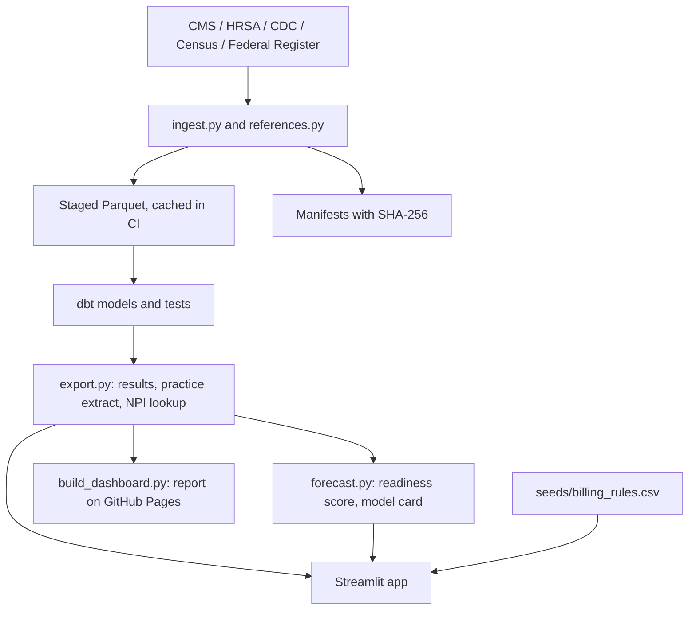

# Architecture

## Design objective

Every number a user sees traces to a public source file, a version and a script. Analysis happens once, in a reproducible pipeline; the app and the report only display and filter its outputs, plus the user's own what-if arithmetic in the payment calculator.

## Component map

| Layer | Component | Responsibility | Must not do |
|---|---|---|---|
| Source adapter | `pipeline/ingest.py` | Resolve each source from its publisher, download with retries, record URL, retrieval time and SHA-256 (`pipeline_output/manifests/`) | Commit raw files; keep clinician names or street addresses |
| Staging | `data/processed/*.parquet` (cached in GitHub Actions, never committed) | Filtered, typed copies of each source | Enter Git |
| Reference checks | `pipeline/references.py` | Fetch Federal Register rule text, CMS payment amount files and condition definitions; check fee arithmetic | Stand in for legal or billing review |
| Warehouse | dbt (DuckDB): staging, intermediate, marts | Primary care definition, practice roll-up, readiness tiers, QMB estimates, equity, payment, opportunity; 48 models and tests | Hide policy rules in the app |
| Export | `pipeline/export.py` | Aggregate results, practice extract, NPI to practice lookup (`pipeline_output/results/`) | Export patient-level or name data |
| Forecast | `pipeline/forecast.py`, `scripts/freeze_forecast.py` | Readiness score and model card; frozen forecast of record in `forecast/frozen_2025_v1/`; one-way freeze with a hash manifest | Overwrite a freeze or train on the outcome |
| Report | `pipeline/build_dashboard.py` | Single-file report page published to GitHub Pages | Fetch data at view time |
| App | `app.py`, `src/apcm_opportunity/dashboard.py` | Findings, practice finder, planner, payment calculator over committed outputs | Recalculate analysis, download source data, or collect patient information |

## Data flow

## Contracts and invariants

- **Grain.** Clinician-year from the CMS by-Provider file; practice is the clinician's most-listed organization in the current Doctors and Clinicians file, else a solo practice.
- **Suppression.** CMS removes clinician-code rows under 11 beneficiaries. A missing row means "fewer than 11 or none", never zero; `mart_suppression` measures what is hidden.
- **Estimates are labeled.** QMB counts are ecological estimates; dollar figures are scenarios with stated inputs (`seeds/apcm_scenarios.csv`); the readiness score is a draft forecast.
- **Rules are cited.** Every APCM rule the app shows comes from `seeds/billing_rules.csv` with its Federal Register page.
- **Fees are checked.** Fee arithmetic must match CMS's published payment amounts in every locality (`pipeline_output/references/pfs_payment_check.csv`).
- **The app is read-only.** It loads committed outputs, holds planner answers only in the browser session, and asks for no patient details.

## CI

| Workflow | Trigger | Does |
|---|---|---|
| `pipeline.yml` | Changes to pipeline, models, seeds, tests | Runs the job in `pipeline/JOB`, commits outputs, republishes the report |
| `app-check.yml` | Changes to the app or its inputs | Runs `app_tests/` headless with Streamlit's AppTest |
| `site-check.yml` | Each Pages deployment | Confirms the report answers at its public URL |
